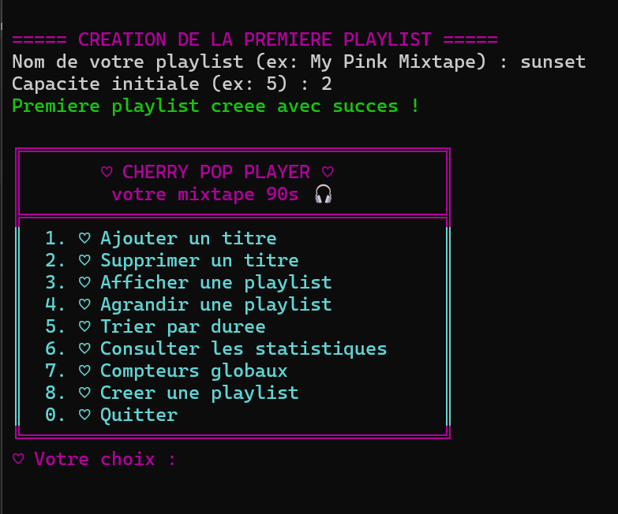

# ♡ Cherry Pop Player

**A simple playlist manager built with C++**

Cherry Pop Player is a lightweight music playlist management application designed to make organizing songs simple and intuitive. It focuses on essential playlist operations, clean organization, and efficient memory management.

## Preview

## Features

- **Playlist Management:** Create and manage multiple playlists.
- **Add Songs:** Add songs with their title, artist, and duration.
- **Remove Songs:** Remove songs from a playlist using their position.
- **Display Playlists:** View playlist details and the songs they contain.
- **Sort Songs:** Organize songs by duration.
- **Playlist Statistics:** Calculate the total duration and display playlist information.
- **Dynamic Capacity:** Expand playlist capacity when more space is needed.
- **Global Counters:** Track the total number of playlists and songs.

## Technical Highlights

- Object-Oriented Programming with C++ classes.
- Encapsulation and relationships between classes.
- Constructors, destructors, and static members.
- Dynamic memory allocation and deallocation.
- Dynamic arrays and basic data management.

## About the Project

Cherry Pop Player was built to explore how a playlist management system works internally, from creating and organizing song objects to managing dynamic memory and maintaining consistent playlist statistics.

The project combines practical C++ programming concepts with a simple, lightweight approach to music organization.

---

*♡ Made with C++ and a love for music.*
